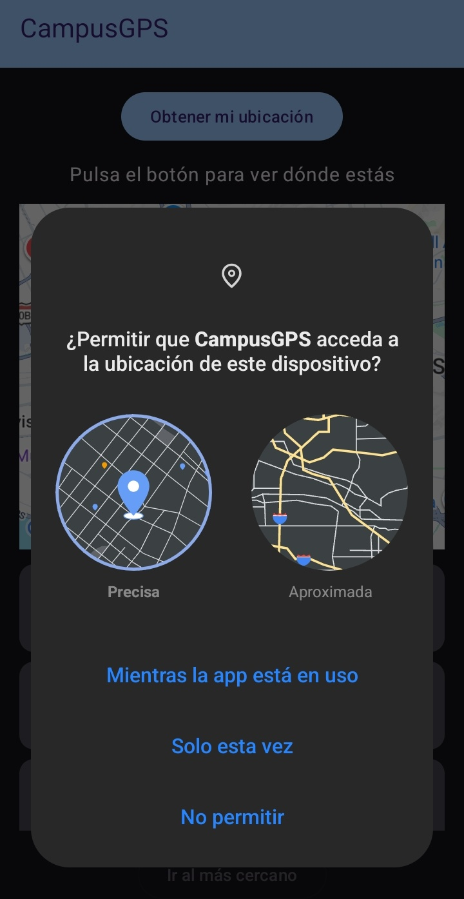
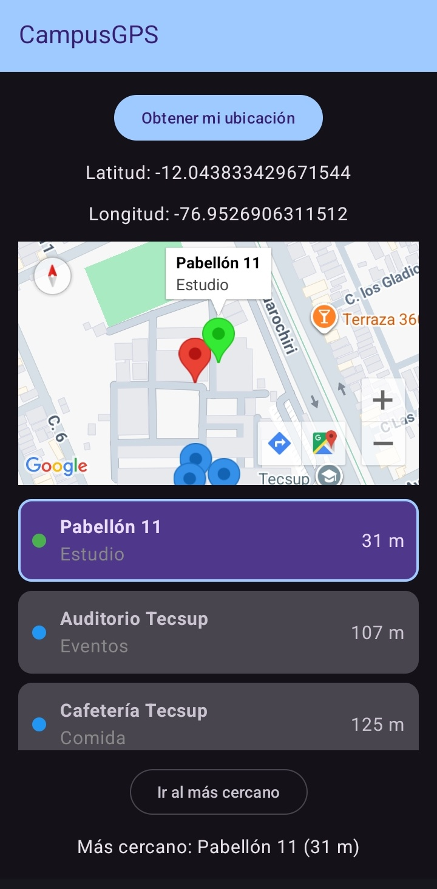
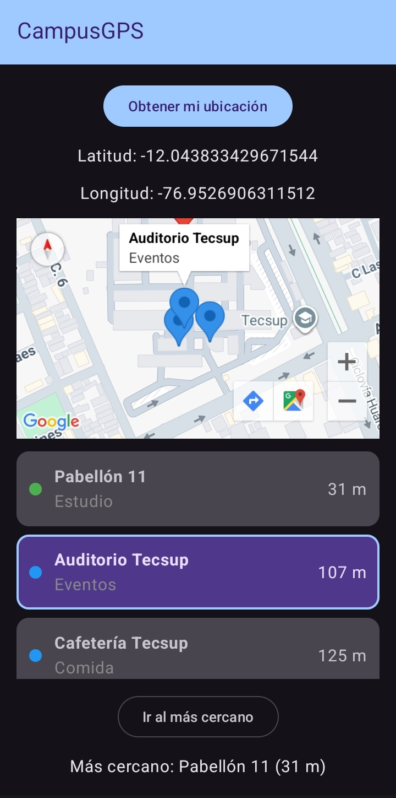
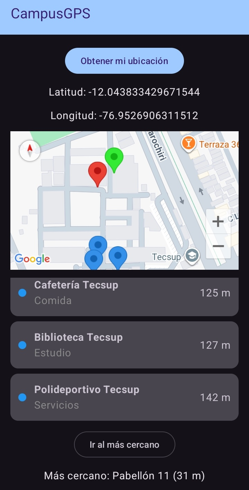
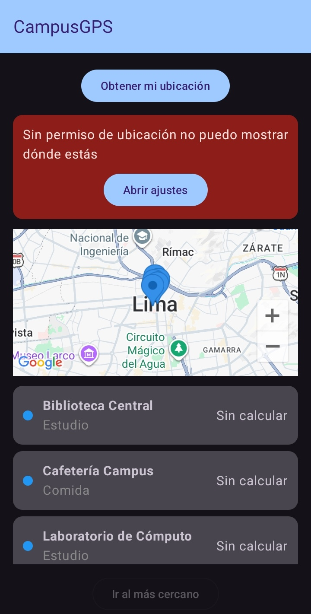

# CampusGPS · Laboratorio 13

App Android que te dice qué lugar del campus tienes más cerca usando el GPS del celular.

- **Alumno:** Carlos Junco
- **Curso:** Programación en Móviles (Localización Geográfica)
- **Docente:** Juan León S.
- **Hecho con:** Kotlin, Jetpack Compose, Material 3, Play Services Location, Maps Compose

## ¿Qué hace la app?

1. Al pulsar **Obtener mi ubicación** pide el permiso de ubicación (solo la primera vez).
2. Con el permiso concedido obtiene la posición con `FusedLocationProviderClient` y muestra la latitud y la longitud.
3. Lleva el mapa hasta donde estoy y pone un marcador rojo **Estás aquí**.
4. Dibuja 5 lugares del campus de **TECSUP** (Av. Cascanueces 2221, Santa Anita) con marcadores azules: Biblioteca Tecsup, Cafetería Tecsup, Pabellón 11, Auditorio Tecsup y Polideportivo Tecsup.
5. Calcula la distancia a cada uno y los lista del más cercano al más lejano (en `m` o `km`).
6. El más cercano sale en verde y el botón **Ir al más cercano** mueve la cámara hasta él. Si toco una tarjeta de la lista, el mapa va a ese lugar y la tarjeta se resalta.

Si algo falla, la app no se cierra:

| Problema | Mensaje | Acción |
|---|---|---|
| Niego el permiso | Sin permiso de ubicación no puedo mostrar dónde estás | Botón **Abrir ajustes** |
| GPS apagado | Activa el GPS e intenta de nuevo | Botón **Reintentar** |
| Sin Google Play Services | Este dispositivo no tiene Google Play Services | Sin botón |

## Organización del código

```
com.junco.campusgps
│
├── MainActivity.kt ................ arranca la app y crea el MapaViewModel con su Factory
│
├── model/Modelos.kt ............... data classes (Posicion, Lugar, LugarConDistancia),
│                                    enum TipoError y los estados de UbicacionUi
├── data/
│   ├── UbicacionRepository.kt ..... contrato para pedir la posición y revisar Play Services
│   ├── UbicacionRepositoryGoogle.kt usa FusedLocationProviderClient (getCurrentLocation)
│   ├── LugaresRepository.kt ....... contrato para obtener los lugares
│   └── LugaresRepositoryLocal.kt .. devuelve los 5 lugares fijos
│
├── util/
│   ├── Distancia.kt ............... distanciaMetros() con Location.distanceBetween
│   └── Formato.kt ................. formatearDistancia() → "88 m" o "1.2 km"
│
├── viewmodel/
│   ├── MapaViewModel.kt ........... guarda el estado en StateFlow y ordena por distancia
│   └── CampusViewModelFactory.kt .. le pasa los repositorios al ViewModel
│
└── ui/
    ├── PantallaMapa.kt ............ Scaffold con la barra, los botones y el permiso
    ├── MapaUbicacion.kt ........... GoogleMap, cámara y marcadores
    ├── ListaLugares.kt ............ tarjetas de los lugares en un LazyColumn
    ├── MensajeError.kt ............ caja roja con el botón según el tipo de error
    └── theme/ ..................... colores, tipografía y tema
```

## Cómo se comunican las capas (MVVM + Repository)

```
 ┌───────────────────────────┐
 │  UI (Composables en ui/)  │  dibuja según el estado y avisa los clics
 └─────────────┬─────────────┘
       eventos │  ▲ collectAsState()
               ▼  │
 ┌───────────────────────────┐
 │       MapaViewModel       │  estado, lugares, seleccionado, masCercano
 └─────────────┬─────────────┘
               │ solo conoce las interfaces
               ▼
 ┌───────────────────────────┐      ┌──────────────────────────────┐
 │    UbicacionRepository    │ ───▶ │  UbicacionRepositoryGoogle   │ (Fused)
 │    LugaresRepository      │ ───▶ │  LugaresRepositoryLocal      │ (5 lugares)
 └───────────────────────────┘      └──────────────────────────────┘
```

- Las pantallas no llaman al Repository ni calculan distancias, solo leen el estado del ViewModel.
- El ViewModel no recibe `Context` ni conoce Composables. Trabaja con las interfaces y la Factory le da las implementaciones.
- `util/` son funciones puras: reciben datos y devuelven un resultado, sin guardar nada.

## Clave de Google Maps

La clave **no se sube a GitHub**. Para correr el proyecto hay que agregarla en `local.properties`:

```
MAPS_API_KEY=tu_clave_aqui
```

En `app/build.gradle.kts` se lee ese archivo con `Properties()` y la clave pasa al Manifest con `manifestPlaceholders["MAPS_API_KEY"]`. El Manifest la recibe en el `<meta-data android:name="com.google.android.geo.API_KEY">`. En Google Cloud la clave está limitada al paquete `com.junco.campusgps` y a la SHA-1 que sale de `./gradlew signingReport`.

## Capturas

Las pruebas se hicieron en el celular con la ubicación simulada (Fake GPS) en `-12.0438, -76.9527`, dentro del campus de TECSUP. Desde ahí el lugar más cercano es el Pabellón 11 (31 m) y el más lejano el Polideportivo Tecsup (142 m).

| 1. Permiso | 2. Mi ubicación en el mapa | 3. Marcadores del campus |
|---|---|---|
|  |  |  |

| 4. Lista por distancia | 5. Error de permiso |
|---|---|
|  |  |

## Para pensar

**1. ¿Por qué `FusedLocationProviderClient` está en el Repository y no en el ViewModel?**

Para crear el cliente de ubicación se necesita un `Context`, y un ViewModel no debería guardar uno: el ViewModel sobrevive cuando se rota la pantalla y la Activity vieja se destruye, así que guardar su `Context` puede dejar memoria sin liberar. Además, obtener la ubicación es "conseguir datos", y eso le toca al Repository. El ViewModel solo pide `obtenerPosicion()` a la interfaz, sin saber si detrás está Google o una lista de prueba.

**2. ¿Qué diferencia hay entre el permiso de ubicación y la clave de API de Maps? ¿Qué pasa si falta cada uno?**

El permiso es la autorización del **usuario** para que la app lea dónde está el celular, y se pide mientras la app corre. La clave de API es la identificación de la **app** ante Google para poder usar el servicio de mapas.
- Sin permiso: el mapa se ve, pero no puedo saber dónde estoy. Sale el mensaje de error con **Abrir ajustes** y los lugares quedan "Sin calcular".
- Sin clave (o con una clave mal restringida): la ubicación y la lista funcionan, pero el mapa sale gris y en Logcat aparece *Authorization failure*.

**3. ¿Por qué la clave va en `local.properties` y no en el código? ¿Qué harías si se subiera a GitHub por error?**

`local.properties` está en el `.gitignore`, así que se queda solo en mi PC. Si la pongo en el código o en el Manifest, termina en GitHub y cualquiera podría usarla a mi nombre. Si se subiera por error, lo primero es **eliminarla en Google Cloud y generar otra**, porque aunque la borre del código sigue visible en el historial de commits. Luego pongo la nueva en `local.properties` y reviso con `git grep` que ya no aparezca en el repo.

**4. ¿Dónde calculas la distancia y por qué no en el Composable?**

La fórmula está en `util/Distancia.kt` (`Location.distanceBetween`) y quien la usa es el ViewModel, en `actualizarDistancias()`, justo cuando `buscar()` recibe la posición. Ahí también ordena la lista y la publica en el `StateFlow`. Si lo calculara dentro de un Composable, se repetiría en cada recomposición y la pantalla tendría lógica, que es justo lo que MVVM quiere evitar. La pantalla solo muestra los metros que ya vienen calculados.

**5. ¿Qué pasa con tu app si el usuario niega el permiso dos veces? ¿Cómo lo manejas?**

Desde Android 11, la segunda negación cuenta como "no volver a preguntar": el cuadro de permiso ya no aparece y el lanzador devuelve `false` sin mostrar nada. Para que el usuario no se quede sin salida, en ese caso llamo a `vm.permisoDenegado()` y la pantalla muestra el error con el botón **Abrir ajustes**, que abre la configuración de la app con `Settings.ACTION_APPLICATION_DETAILS_SETTINGS`. Ahí el usuario puede activar la ubicación a mano y luego volver a pulsar el botón.
